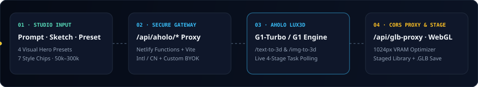
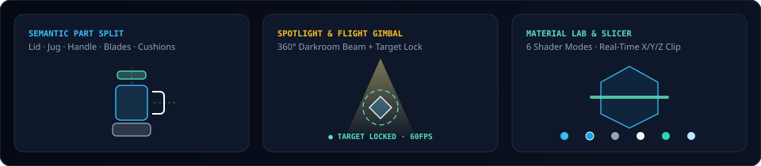

<div align="center">


<br />

# ✦ LuxStage

**Interactive Generative 3D Playground & Staging Studio for Manycore Aholo Lux3D**  
*Built for the Manycore Aholo Global 3D AI Hackathon*

[](https://www.aholo.ai/hackathon)
[](#live-links--demo)
[](#live-links--demo)
[](https://github.com/pmndrs/react-three-fiber)
[](./LICENSE)

<p align="center">
  <b>Generate PBR 3D assets from text prompts or 2D sketches with Aholo Lux3D · Inspect shaders &amp; topology · Disassemble meshes along real functional parts · Test Zero-G physics &amp; spotlights · Export React Three Fiber code &amp; <code>.glb</code> assets.</b>
</p>

</div>

---

## 🌐 Live Links & Demo

| Resource | Link |
| :--- | :--- |
| **Live Web App** | *Paste deployed Netlify URL here* |
| **Demo Walkthrough Video** | *Video link coming soon* |
| **Source Repository** | [github.com/grzdev/luxstage](https://github.com/grzdev/luxstage) |

---

## ✦ What LuxStage Does

Most text-to-3D tools stop the moment a `.glb` file finishes downloading. **LuxStage** wraps **Aholo Lux3D** inside a full interactive 60fps WebGL darkroom so creators, designers, and developers can generate a 3D asset and immediately stress-test, inspect, disassemble, light, slice, and export it—all inside a responsive desktop & mobile browser.

---

## ⚡ Every Aholo Integration Used

<div align="center">
  
</div>

<br />

| Integration Layer | What It Powers | Implementation |
| :--- | :--- | :--- |
| **Text-to-3D & Image-to-3D Cloud API** | Calls `/global/lux3d/v1/generate/text-to-3d/task/create` (with optional reference `img`) and `/generate/img-to-3d/task/create`, supporting **`G1-Turbo`** and **`G1` (HD)** engines, `50k–300k` target polygon slider, and **7 Aholo styles** (`Photorealistic`, `Cyberpunk`, `Fantasy`, `Cartoon`, `Anime`, `Hand Painted`, `Glass`). | [`src/services/aholo.ts`](src/services/aholo.ts)<br/>[`src/components/generation/GenerationStudio.tsx`](src/components/generation/GenerationStudio.tsx) |
| **Real-Time Task Polling & Pipeline UI** | Polls `/generate/task/get?taskid=...` and maps cloud generation status (`0` queued → `1` processing → `3` success) into a 4-stage live progress interface (*Connecting → Sculpting Geometry → Baking PBR → Mounting GLB*). | [`src/hooks/useAholoGeneration.ts`](src/hooks/useAholoGeneration.ts) |
| **Curated Visual Presets & Glass Tuning** | One-click tuned prompts (**Kitchen Blender**, **Concept Sneaker**, **Tactical Drone**, **White Headphones**) plus automatic translucent frosted-glass shader treatment on glass pitcher geometry. | [`src/components/generation/GenerationStudio.tsx`](src/components/generation/GenerationStudio.tsx)<br/>[`src/spatialkit/SelectableModel.tsx`](src/spatialkit/SelectableModel.tsx) |
| **Dual-Region Proxy & BYOK Override** | Proxies `/api/aholo/*` across **International** (`api.aholo.ai/global/lux3d/v1`) and **China** (`api.aholo3d.cn/lux3d/v1`) via `X-Aholo-Region`. Visitors can use the hosted server key (`/api/aholo/key-status`) or override it in **⚙ API Key** (`X-Aholo-Key`, stored in `localStorage`). | [`netlify/functions/aholo.mjs`](netlify/functions/aholo.mjs)<br/>[`vite.config.ts`](vite.config.ts)<br/>[`src/components/SettingsModal.tsx`](src/components/SettingsModal.tsx) |
| **Cross-Origin GLB Streaming & Export** | `/api/glb-proxy` streams remote Aholo CDN `.glb` binaries with clean CORS headers for WebGL rendering, paired with bottom-left **Download GLB** and per-card `.glb` downloads. | [`netlify/functions/glb-proxy.mjs`](netlify/functions/glb-proxy.mjs)<br/>[`src/model-files.ts`](src/model-files.ts) |
| **Browser Staged Library & Gzip Loader** | Separates **Your Generated Models** (saved locally in `localStorage` with load, download & remove controls) from zero-credit **Starter Showcase Presets** (`Quadruped Robotic Dog` streamed via `robot-dog.glb.gz` + `Tactical Sci-Fi Helmet`). | [`src/services/aholo.ts`](src/services/aholo.ts)<br/>[`src/spatialkit/SelectableModel.tsx`](src/spatialkit/SelectableModel.tsx) |
| **Aholo SDK & Cloud Task Wrappers** | Ships `@manycore/aholo-sdk-lux3d`, `@manycore/aholo-sdk-core`, and `@manycore/aholo-sdk-asset` dependencies alongside typed `/part-split/task/create` and `/articulation-animation/task/create` helpers for cloud geometry workflows. | [`package.json`](package.json)<br/>[`src/services/aholo.ts`](src/services/aholo.ts) |

---

## 🕹️ The 7 Interactive Stage Tools

<div align="center">
  
</div>

<br />

| Tool | What You Can Do |
| :--- | :--- |
| **✦ Material Lab** | Flip generated PBR assets across **6 live shader modes** (`Aholo PBR`, `Topology X-Ray`, `Studio Clay`, `Liquid Chrome`, `Cyber Hologram`, `Frosted Acrylic`), toggle a wireframe topology overlay, and slide roughness & metalness in real time. |
| **🔦 Spotlight** | Drop the stage into a darkroom and sweep a **360° clockwise orbit dial** alongside mechanical **brightness** and **height** levers to inspect silhouettes, surface normals, and reflections. |
| **🎯 Gimbal** | Put your generated model into autonomous 3D flight and steer a fighter-jet targeting reticle using a **2-axis tactile joystick** to achieve 60fps missile lock (`● TARGET LOCKED`). |
| **📐 Spatial Rig** | Wrap the asset in a **3D CAD dimension cage (`W × H × D`)**, inspect live triangle/vertex telemetry, adjust `0.4×–1.8×` scale, trigger **Zero-G Float** or a **Newtonian Gravity Drop Test**, download `.glb`, or copy **React Three Fiber** code. |
| **🧩 Part Split** | Zero-latency anatomy-aware semantic segmentation built for single-shell AI meshes: separates **Blender** (lid, glass jug, handle, collar, dial, base), **Drone** (4 blades, 4 motor arms, fuselage, gimbal), **Headphones** (headband, hinges, inner foam cushions, outer housings), **Sneaker**, and **Quad Bot** (with 10-zone fallback for any custom `.glb`). |
| **🎨 Studio** | Switch lighting environments (`Showroom`, `Blueprint`, `Cyberpunk`, `Warm Clay`), pick custom backdrop colors, and capture studio PNG snapshots. |
| **✂️ Slicer** | Slice real-time WebGL clipping planes across **`Z`**, **`X`**, and **`Y`** axes to inspect interior topology and wall thickness. |

---

## 🧱 Architecture

```text
LuxStage (React 18 · TypeScript · React Three Fiber · Three.js)
├── src/components/generation/   # Text/Image-to-3D Studio, Presets & Staged Library
├── src/services/aholo.ts        # Lux3D task create/poll, BYOK auth & storage persistence
├── src/hooks/useAholoGeneration.ts
├── src/spatialkit/              # Model optimizer, semantic Part Split, PBR shaders & rigs
├── netlify/functions/           # Serverless /api/aholo/* & /api/glb-proxy CORS relays
└── vite.config.ts               # Local dev middleware matching production routes
```

---

## 🚀 Getting Started

```bash
git clone https://github.com/grzdev/luxstage.git
cd luxstage
npm install
```

Create `.env.local` in the project root (or enter your key directly in the top-bar **⚙ API Key** dialog at runtime):

```env
VITE_AHOLO_API_KEY=your_aholo_api_key_here
```

Run locally or build for production / Netlify:

```bash
npm run dev      # Starts Vite on http://localhost:5174
npm run build    # Typechecks and builds production bundle into dist/
```

For **Netlify**, `netlify.toml` auto-configures builds and serverless API redirects—add `AHOLO_API_KEY` (or `VITE_AHOLO_API_KEY`) under **Site configuration → Environment variables**.

---

## 📄 License

MIT © 2026
