<div align="center">



<br />

# ✦ LuxStage

**Generate 3D models with Aholo Lux3D — then disassemble, light, slice, fly, and export them live in your browser.**  
*Built for the Manycore Aholo Global 3D AI Hackathon*

[](https://luxstage.netlify.app/)
[](https://drive.google.com/file/d/15XD_fbg4DB_7AZ4EcGKQ-a9J7YKN6xRb/view?usp=sharing)
[](https://www.aholo.ai/hackathon)
[](https://github.com/pmndrs/react-three-fiber)
[](./LICENSE)

<p align="center">
  <b>Prompt or sketch in Aholo Lux3D · Flip real-time PBR &amp; X-Ray shaders · Explode real functional parts · Sweep darkroom spotlights · Missile-lock target tracking · Export <code>.glb</code> &amp; React Three Fiber code.</b>
</p>

</div>

---

## 🌐 Live & Demo

- **▶ Live App:** **[luxstage.netlify.app](https://luxstage.netlify.app/)** — Works out of the box on desktop &amp; mobile (or paste your own Aholo key via **⚙ API Key**)
- **🎬 Demo Walkthrough Video:** **[Watch on Google Drive →](https://drive.google.com/file/d/15XD_fbg4DB_7AZ4EcGKQ-a9J7YKN6xRb/view?usp=sharing)**

---

## 🎮 Inside the Playground

Most text-to-3D apps stop the second a `.glb` finishes downloading. **LuxStage** wraps **Aholo Lux3D** in an interactive 60fps WebGL darkroom built for both desktop and mobile—turning raw AI geometry into something you can inspect, dissect, stress-test, and ship.

<div align="center">
  
</div>

<br />

### 1. Generative Studio (`✦ Generate 3D Model`)
- **Text-to-3D & Image-to-3D:** Type any prompt, upload a 2D reference image, or click curated presets (**Kitchen Blender**, **Concept Sneaker**, **Tactical Drone**, **White Headphones**).
- **Aholo Engine & Style Controls:** Choose **`G1-Turbo`** or **`G1` HD**, tune target mesh density (`50k–300k` faces), and pick from **7 Aholo styles** (`Photorealistic`, `Cyberpunk`, `Fantasy`, `Cartoon`, `Anime`, `Hand Painted`, `Glass`).
- **Staged Library & Direct Downloads:** Automatically saves your generated models in **Your Generated Models** cleanly separated from built-in **Starter Showcase Presets** (`Quadruped Robotic Dog` & `Tactical Sci-Fi Helmet`), with a dedicated **Download GLB** button right under the bottom-left model badge and per-card `.glb` downloads inside the library.

### 2. The 7 Interactive Stage Tools

| Tool | What You Can Play With |
| :--- | :--- |
| **✦ Material Lab** | Flip generated assets across **6 live shaders** (`Aholo PBR`, `Topology X-Ray`, `Studio Clay`, `Liquid Chrome`, `Cyber Hologram`, `Frosted Acrylic`), toggle wireframe overlay, dial roughness & metalness live, and render translucent glass automatically on **Blender** pitcher geometry. |
| **🔦 Spotlight** | Drop into a pitch-black darkroom and spin a **360° clockwise orbit dial** with mechanical **brightness** and **height** levers to inspect silhouettes, surface normals, and specular highlights. |
| **🎯 Gimbal** | Launch your generated model into autonomous 3D flight and steer a fighter-jet camera turret via a **2-axis tactile joystick** to achieve 60fps missile lock (`● TARGET LOCKED`). |
| **🧩 Part Split** | Zero-latency **anatomy-aware semantic split** built for single-mesh AI outputs: lifts the **Blender** lid, slides the handle radially, keeps its glass jug intact; lifts **Drone** blades off 4 arms + drops camera gimbal; pops **Headphones** foam cushions inward off outer housings & headband; splits **Sneaker** and **Quad Bot** (plus a 10-zone split for any custom `.glb`). |
| **📐 Spatial Rig** | Toggle a **3D CAD dimension cage (`W × H × D`)**, inspect live polygon telemetry, scale `0.4×–1.8×`, float in **Zero-G**, trigger a **Newtonian Gravity Drop Test**, download `.glb`, or copy **React Three Fiber** code. |
| **🎨 Studio** | Switch environment presets (`Showroom`, `Blueprint`, `Cyberpunk`, `Warm Clay`), apply custom backdrop swatches, and capture PNG studio snapshots. |
| **✂️ Slicer** | Sweep a real-time WebGL cross-section plane across **`Z`**, **`X`**, and **`Y`** axes to inspect interior mesh thickness and cavities. |

---

## ⚡ How Aholo Lux3D Powers LuxStage

<div align="center">
  
</div>

<br />

- **Live Cloud Synthesis & Polling:** Dispatches `/generate/text-to-3d/task/create` and `/generate/img-to-3d/task/create`, tracking `/generate/task/get` across a 4-stage visual loading pipeline (`Connecting → Sculpting → Baking PBR → Mounting`).
- **Dual-Region Serverless Gateway + BYOK:** Routes `/api/aholo/*` through Netlify Functions & Vite dev middleware across **International (`api.aholo.ai`)** and **China (`api.aholo3d.cn`)**, supporting visitor overrides via **⚙ API Key** in `localStorage`.
- **CORS GLB Relay & Instant Startup:** Streams remote Aholo `.glb` outputs via `/api/glb-proxy`, serves a gzip-streamed `robot-dog.glb.gz` hero asset on startup, and optimizes WebGL textures (`>1024px`) while preserving full `.glb` source files for download.
- **Aholo SDK & Cloud Hooks:** Includes `@manycore/aholo-sdk-lux3d`, `@manycore/aholo-sdk-core`, and `@manycore/aholo-sdk-asset` alongside typed wrappers in [`src/services/aholo.ts`](src/services/aholo.ts) for `/part-split/task/create` and `/articulation-animation/task/create`.

<details>
<summary>⚙️ View Full Aholo API, Proxy &amp; File Integration Breakdown</summary>

<br />

| Integration Layer | Details | Source File(s) |
| :--- | :--- | :--- |
| **Text-to-3D & Image-to-3D API** | `/global/lux3d/v1/generate/text-to-3d/task/create` (with optional reference `img`) & `/generate/img-to-3d/task/create`, `G1-Turbo` / `G1`, `50k–300k` polygon budget, 7 styles. | [`src/services/aholo.ts`](src/services/aholo.ts)<br/>[`src/components/generation/GenerationStudio.tsx`](src/components/generation/GenerationStudio.tsx) |
| **Async Task Polling** | Polls `/generate/task/get?taskid=...` and maps status `0 → 1 → 3` into live progress percentages and stage labels. | [`src/hooks/useAholoGeneration.ts`](src/hooks/useAholoGeneration.ts) |
| **Serverless Region Proxy & BYOK** | Netlify `:splat` + Vite proxy for Intl (`api.aholo.ai`) and CN (`api.aholo3d.cn`), `/api/aholo/key-status`, and `X-Aholo-Key` visitor overrides. | [`netlify/functions/aholo.mjs`](netlify/functions/aholo.mjs)<br/>[`vite.config.ts`](vite.config.ts)<br/>[`src/components/SettingsModal.tsx`](src/components/SettingsModal.tsx) |
| **GLB Streaming, Gzip & Export** | `/api/glb-proxy` CORS stream, `robot-dog.glb.gz` `DecompressionStream` preloader, `1024px` WebGL texture downscaler, and shared `downloadModelFromSource()` `.glb` exporter. | [`netlify/functions/glb-proxy.mjs`](netlify/functions/glb-proxy.mjs)<br/>[`src/model-files.ts`](src/model-files.ts)<br/>[`src/spatialkit/SelectableModel.tsx`](src/spatialkit/SelectableModel.tsx) |
| **Semantic Splitter & SDK Foundation** | Installed `@manycore/aholo-sdk-*` packages, local anatomy-aware semantic `Part Split`, and typed `createPartSplitTask` / `createArticulationTask` wrappers. | [`package.json`](package.json)<br/>[`src/spatialkit/model.ts`](src/spatialkit/model.ts)<br/>[`src/services/aholo.ts`](src/services/aholo.ts) |

</details>

---

## 🚀 Quick Start & Deployment

```bash
git clone https://github.com/grzdev/luxstage.git
cd luxstage
npm install
```

Create `.env.local` in the project root (or paste your key inside the UI via **⚙ API Key**):

```env
VITE_AHOLO_API_KEY=your_aholo_api_key_here
```

```bash
npm run dev      # Local dev server on http://localhost:5174
npm run build    # Typecheck & bundle into dist/
```

For **Netlify**, [`netlify.toml`](netlify.toml) pre-configures builds and serverless redirects—set `AHOLO_API_KEY` (or `VITE_AHOLO_API_KEY`) in **Site configuration → Environment variables**.

---

## 📄 License

MIT © 2026
